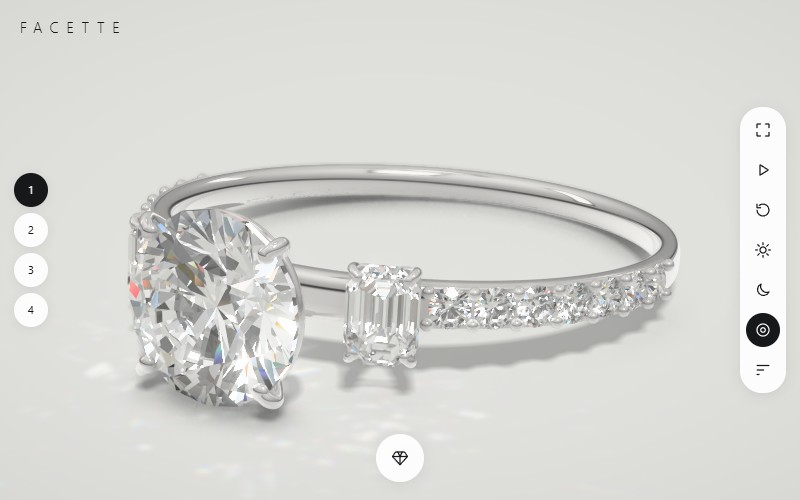
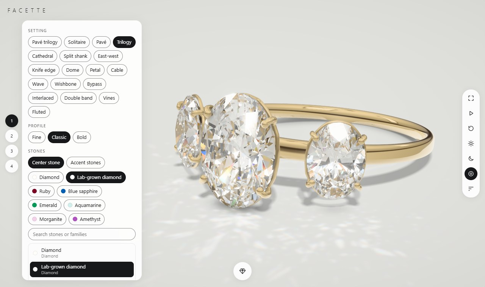

# Facette

<a href="https://buymeacoffee.com/regard2462"></a>

3D jewelry viewer for the browser. Three.js with WebGPU, WebGL 2 as fallback. Everything is rasterized, with no path tracing and no textures: rings, cuts and studio are generated in code. A ring editor sets the setting style, stones, cut, carat weight, metal and band. Your own rings load as GLB.



Live viewer: https://regard2462.github.io/Facette/

Demo video (85 s, 1280 × 720): [preview/demo.mp4](preview/demo.mp4)

## Getting started

```bash
npm install
```

```bash
npm start
```

Then open `http://127.0.0.1:5199/`. The page needs a server and does not load when opened as a file.

- Other port: `node server.mjs 8080` or the `PORT` environment variable.
- Local network (phone test): environment variable `HOST=0.0.0.0`. Browsers offer WebGPU only on secure origins, so a phone on plain http over a network address shows WebGL 2. To test WebGPU, connect an Android phone over USB, run `adb reverse tcp:5199 tcp:5199` and open `http://localhost:5199/` on the phone, or use HTTPS.
- The server only serves `index.html`, `src/`, `preview/`, `models/` and Three. The rest of the project folder stays hidden.
- Browser: WebGPU (current Chrome, Edge, Safari) or WebGL 2. Without either, the page shows a message.

## Controls

- Drag to rotate, wheel or pinch to zoom.
- Left: four views.
- Right: fullscreen, turntable, reset camera, light (direction, elevation, rotate studio), light or dark studio, depth of field, quality.
- Bottom (diamond button): ring editor, see below. While the editor is open, the image moves to the right.
- Depth of field is on by default. The overview keeps the whole ring sharp, closer views soften the back of the band, the macro view strongly. Clicking the ring focuses on that point.
- Keyboard: click the image or select it with Tab. The arrow keys rotate and tilt, plus and minus zoom. Escape closes the panels.
- With the light panel open, a gizmo appears in the image. Drag the light point freely, drag the ground ring to rotate, drag the arc to tilt.
- Quality: without a choice, WebGPU starts on Medium and WebGL on Low. If the image runs below 24 frames per second, the page steps down one level by itself. Turning off depth of field saves render time.
- When the image is still, the page stops drawing after about 45 frames. This saves battery and heat.
- Shader compile errors, device errors and out of memory errors appear at the top of the page. After a render error the page stops drawing, so it does not fail again on every frame.

URL parameters:

- `?q=low|mid|high` fixed quality, without automatic step down
- `?scene=dark` dark studio
- `?dof=0`, `?ssr=0`, `?ao=0` turn off depth of field, screen space reflections and ambient occlusion
- `?webgl` forces WebGL 2
- `?fps` shows frame time, frames per second, quality level, graphics API and buffer size (for measuring on real devices)
- `?model=models/name.glb` loads a GLB from the `models/` folder at startup (only this folder, only `.glb`)
- `?trace` collects errors in `window.__errs`

## Ring editor

The panel on the left rebuilds the ring on every change. View direction and turntable stay where they are. The image moves into the free space next to the panel, and the camera backs off until the ring fits.



- **Setting**: 18 styles: Pavé trilogy (default ring), Solitaire, Pavé, Trilogy, Cathedral, Split shank, East-west, Knife edge, Dome, Petal, Cable, Wave, Wishbone, Bypass, Interlaced, Double band, Vines, Fluted. Each style brings its own band and pavé.
- **Profile**: fine, classic, bold (thickness of band, prongs and gallery).
- **Stones**: center stone or accent stones (side stones and pavé), quick picks and a library of 86 gemstones with search by name or family. Each gemstone has a refractive index, dispersion, density and absorption per millimeter.
- **Center stone cut**: Brilliant, Oval, Marquise, Pear, Cushion, Princess, Emerald, Asscher, Radiant, Baguette, Trillion, Old European, Old mine, Rose, Hexagon, Kite.
- **Center stone weight**: 0.5 to 3 ct. The size follows from weight, cut volume and the density of the gemstone. A ruby of the same weight is smaller than a diamond, and a 1 ct round brilliant diamond measures 6.5 mm.
- **Metal**: Platinum, White gold, Palladium, Silver, Yellow gold 18k, Yellow gold 14k, Rose gold.
- **Edit band**: shape (round, flat, domed, knife edge), back width, thickness, shoulders (straight, tapered, flared, split) with their own width, finish (polished, brushed, hammered), edge (plain, bevel, milgrain), pavé with one to three rows, stones per side, weight per stone, spacing, and graduated or equal stones. "Reset band" restores the defaults of the style.

## Your own models (GLB)

At the bottom of the panel, use "Load own GLB" or drop the file on the window. "Show design" brings back the ring from the editor. Below the buttons the page lists what it recognized, with warnings.

- **Stones**: parts with a transparent material (transmission or opacity below 1) or with a stone word in the part or material name (Diamond, Brilliant, Gem, Stone, Emerald, Ruby, Sapphire, Crystal, CZ and German forms). The gemstone type also comes from the name, otherwise diamond.
- **Metal**: everything else. It gets the viewer's metal, so the metal choice in the panel applies to loaded rings as well.
- **Facet planes**: each stone is split into facet planes that the gem shader traces (at most 96). Non convex stones are replaced by their convex hull, with a warning. Stones with too many planes (round spheres, for example) stay plain glass.
- **Groups**: the largest stone is the center stone, stones from 30 % of its size are side stones, the rest is pavé.
- **Orientation**: the smallest extent becomes the finger axis, the head points towards the center of mass of the stones (by volume), and the width is scaled to that of the default ring. The ring then lies like the default ring. This works for models saved axis aligned, in any axis and scale.
- `tools/examplemodel.mjs` writes the built-in ring as `models/example.glb`, and `tools/modeltest.mjs` uses it to check loading, facet planes, position and orientation:

```bash
node --import ./tools/three-hook.mjs tools/modeltest.mjs
```

## How it works

- **Stones** (`src/gem.js`): the fragment shader traces the view ray against the real facet planes of the cut. Refraction on entry, three to seven total internal reflections, exit with Fresnel and a separate refractive index per color channel (fire). Colored stones absorb per millimeter of path (values from `src/library.js`), so small stones look paler than large ones. A different cut only rewrites the planes in a uniform array, the shader stays the same.
- **Probes**: a cube probe at the center stone (256) and one per side stone (128, up to four). They hold the studio, the metal, the floor in the light studio, and the neighboring stones as a faceted mirror in their color. Pavé and further side stones use the probe of the center stone. While the light or the turntable moves, the side probes update every third frame, then once in full.
- **Cuts** (`src/gemcut.js`): 16 cuts as plane sets, at most 96 planes per stone. They yield mesh and shader data, plus volume (for the weight), outline per direction and prong directions (corners, points, corner facets). The emerald cut has a wide table (`table`, fraction of the stone width, default 0.72).
- **Caustics** (`src/caustics.js`): photon splatting for center and side stones. Each stone gets a point grid from the light direction, and the vertex shader refracts every photon through the stone onto the floor. A height map of the metal blocks photons on the way from lamp to stone and from stone to floor. Pavé sits in the metal and casts no caustics.
- **Studio** (`src/studio.js`): softboxes and long strip lights, rendered once into an HDR cube texture. The metal sees a version without sparkle lights and without black flags (they would show as black spots on the mirror), the stones a brighter one with both. The studio rotates with the light. The dark studio surrounds the ring like a product shot on black: a few large softboxes that fade out softly from center to edge, black in between, so gold shows warm highlights that run in long gradients into deep shadows.
- **Metal color** (`src/main.js`): metals get a color grade at the end of their material. Highlights above a knee roll off softly, shadows turn warm brown, and the brightest areas fade slightly towards a pale tone. Each metal in `src/ring.js` has a `warm` value (yellow gold 18k 1, 14k 0.75, rose gold 0.5, white metals 0) that scales the grade, so platinum and silver stay neutral. In the dark studio, gold gets less environment light than the white metals (1.6 against 1.8).
- **Ring editor** (`src/design.js`): builds a design from band (`src/band.js`, cross section per style and angle, normals from the cross section), heads (`src/head.js`, prongs grow from the band along the pavilion over the crown, galleries follow the stone outline), pavé (`src/pave.js`, seats along the shoulder with beads) and finishes (`src/finish.js`, bump mapping from noise in the shader). Stone materials live in a fixed pool per seat, so a rebuild needs no new shader and no new probe. The default design rebuilds the hand-placed ring from `src/ring.js` vertex for vertex.
- **Metal and setting of the default ring** (`src/ring.js`): high polish (roughness 0.05). The band is a lathe profile with flat sides and rounded edges, tapering towards the bottom. The center stone sits in a basket: four tapering prongs grow from the band, follow the pavilion at a fixed distance and grip over the crown with flat tips, and two gallery rings run right through them. Each side stone has a basket of four corner prongs with a gallery that carries the stones overhanging the band. The pavé is as wide as the band and set so deep that the girdle lies in the band, and neighbors share one ball prong. A narrow ledge runs under both edges of the row and fills the rounded band edge, so the girdle does not stand over the edge. The directional lamp casts only shadows and caustics, since its highlight would be a harsh spot on the mirror.
- **Floor**: shadow catcher with soft shadows (VSM; stones, ball prongs and side prongs cast none, otherwise streaks appear), caustics, and in the dark studio a faint, blurred reflection of the ring.
- **Camera**: long focal length (16°). In the overview the ring fills about 70 % of the image width. Distances, and with them the depth of field, stay as with 20°.
- **Depth of field** (`src/lensblur.js`): custom lens filter. Each pixel samples a spiral and only takes neighbors whose circle of confusion reaches it, so sharp stones do not bleed into the soft background. The strength grows faster towards the macro view than with a real lens. When the image is still, the sample pattern changes every frame and the filter averages up to 16 frames, which removes grain from the bokeh.
- **Screen space**: GTAO with denoising, reflections on metal (SSR, WebGPU only, from Medium; hits are refined between two steps, otherwise the band under the stone shows stair steps at grazing angles), temporal anti-aliasing (TRAA, FXAA under WebGL), bloom, vignette.

## Headless checks

`tools/shots.mjs` starts Edge without a window, sets view and camera by script and saves images next to the job file. Run it from PowerShell while the server runs (for example `node server.mjs 5288`):

```bash
node tools/shots.mjs check.json
```

Job: `{ "url": "http://127.0.0.1:5288/?trace", "w": 800, "h": 500, "shots": [ { "js": "viewer.goView(2, true)", "wait": 3000, "out": "macro.png" } ] }`. If the script returns `{ click: [x, y] }`, the tool clicks there like a mouse.

`tools/video.mjs` records a video frame by frame. A script sets camera, light and focus for each frame, the tool waits a few frames until anti-aliasing and depth of field have settled, and pipes everything to ffmpeg (must be on the PATH). The video stays smooth even when a frame takes longer to render.

```bash
node tools/video.mjs tools/demo-script.js demo.mp4 --url "http://127.0.0.1:5288/?q=high"
```

Options: `--parts light,dark`, `--w 1920 --h 1080`, `--fps 30`, `--settle 4` (frames to wait for each frame), `--from` and `--to` (seconds), `--every n` (only every nth frame, for quick trials), `--frames` (keep the single frames).

`tools/defaultring.mjs` checks that the built-in ring stays the same, mesh for mesh:

```bash
node --import ./tools/three-hook.mjs tools/defaultring.mjs
```

For the ring editor, all without a GPU:

- `tools/bandtest.mjs`: bands of all styles, shapes and shoulders without invalid values, outside facing out, dimensions of the default ring.
- `tools/headtest.mjs`: heads for all cuts, sizes, profiles and bands. No metal inside the stone, every prong touches the stone, every tip lies above the girdle on the crown, every root sits in the band, and the stone floats above it.
- `tools/pavetest.mjs`: pavé without overlaps, every girdle rests on metal, seven stones per side on the default band.
- `tools/designtest.mjs`: 720 designs across all styles, weight of a 1 ct brilliant, default design equal to the hand-placed ring, fixed material pool.
- `tools/cuttest.mjs`: all 16 cuts with a closed mesh, at most 96 planes, volume, girdle and prong directions. Brilliant and emerald cut match their reference proportions.

## Preview

In `preview/`: `light.jpg`, `macro.jpg`, `gold-side.jpg`, `gizmo.jpg`, `dark.jpg`, `dark-gold.jpg` (800 × 500), `editor.jpg` (1280 × 760, trilogy in yellow gold with the panel open) and `demo.mp4`: platinum in the light studio with a circling light and macro shots, then yellow gold in the dark studio, close to the pavé and the center stone.

## Known limitations

- Frame rate and cost of the side probes are not measured on real phones. `?fps` is there for that.
- GLB orientation works in quarter turns only, so models saved at an angle stay tilted. Models without recognized stones keep their own up axis unless it is the finger axis.
- Pavé and side stones from the fifth on use the probe of the center stone, so their perspective is approximate.
- The four views are tuned to the size of the default ring. Large designs (a 1.2 ct trilogy, for example) almost fill the image when the panel is closed.

## License

AGPL-3.0-or-later. Gemstone data, band cross section and pavé seats come from [mobicats-jewels](https://github.com/shaarmander/mobicats-jewels) and are under MIT, as is Three.js. Details in `NOTICE`.
